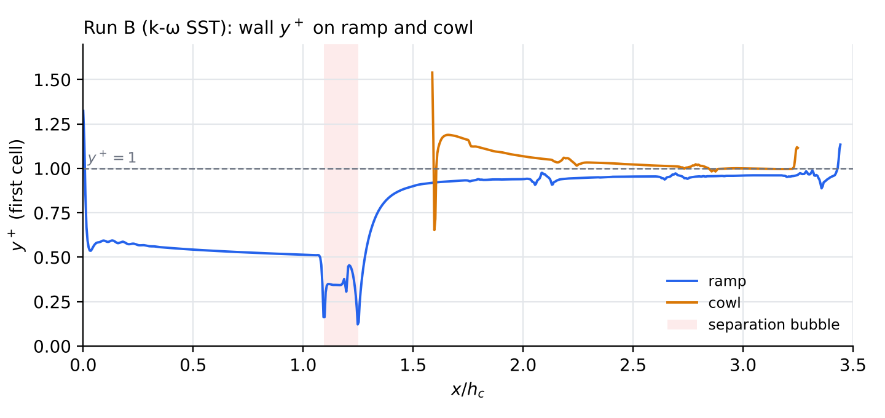
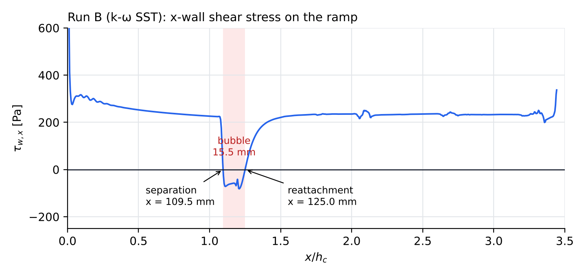
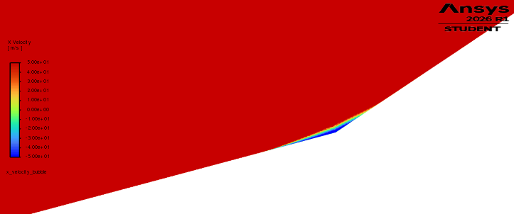
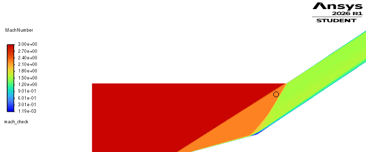

# Phase 3b — Viscous CFD validation, M = 3, 2-ramp design

Phase 3b adds the boundary layer to the Phase 3a inviscid case. It has two runs on one
boundary-layer-resolving mesh:

- **Run A (inviscid)** checks that the new mesh reproduces the validated 3a solution.
- **Run B (viscous, k-omega SST)** measures how much the boundary layer degrades the
  inviscid-optimal (Oswatitsch equal-strength) design.

## Setup

- Ansys Fluent 2026 R1 Student, 2D planar, density-based implicit, Roe-FDS, least-squares
  gradients, second-order upwind flow. Ideal-gas air, operating pressure 0 Pa.
- Freestream: M = 3, p = 10 000 Pa, T = 220 K (pressure-far-field on `inlet` and
  `top_freestream`). Capture height h_c = 0.1 m. Ideal captured mass flow
  rho V h_c = 14.13 kg/s per metre span.
- Same design-point domain as 3a (`inletdesign cfd-domain`).

### Mesh

- About 262 000 cells (about 37 000 quads in the inflation layers, triangles in the core),
  under the 512k Student limit.
- Inflation on `ramp`, `cowl`, `symmetry` and `top_freestream`: first layer 5 µm, 28 layers,
  growth rate 1.2.
- Minimum orthogonal quality (Fluent) **0.60**, maximum aspect ratio 127.
- Inflating only the walls first gave min OQ 0.0032 at the cowl lip and 0.015 at the ramp
  leading edge, where the layers ended abruptly. Extending the inflation onto `symmetry` and
  `top_freestream` removed both bad cells.

## Run A — inviscid mesh check

### Start-up

A uniform M = 3 initialization diverged within about 40 iterations at every Courant number
tried (0.5 to 2). Static temperature was clamped at 5000 K in the 5 µm cells along the 34°
second ramp. This is above the 616 K stagnation temperature, so it is non-physical. The cause
is an impulsive start: the uniform x-directed flow slams into the ramp before any shock has
formed, and the very thin cells cannot absorb it. FMG initialization failed the same way.

The fix was to interpolate the converged 3a solution onto the new mesh
(File → Interpolate). Starting from a field that already contains the shock system, the run
was stable. Courant 2 excited a slow, decaying rocking of the lip shock; Courant 1 and then
0.5 were used.

### Results (mean of the last 400 of 2500 iterations)

| Quantity            | Tool       | 3a CFD    | 3b Run A           | vs 3a   | vs tool |
|---------------------|-----------:|----------:|-------------------:|--------:|--------:|
| p after shock 1     | 28 176 Pa  | 28 154 Pa | 28 160 Pa          | +0.02%  | -0.06%  |
| p in duct           | 79 389 Pa  | 79 324 Pa | 79 284 Pa          | -0.05%  | -0.13%  |
| p0 at outlet        | 294 527 Pa | 293 492 Pa| 293 889 Pa (±80)   | +0.14%  | -0.22%  |
| Mass flow at outlet | 14.13 kg/s | —         | 14.085 kg/s        | —       | -0.3%   |

Net mass imbalance: 0.0063 kg/s (0.045% of capture).

The new mesh reproduces 3a within 0.15% everywhere, so it is validated for the viscous run.
The outlet total pressure moves closer to the tool (−0.22% here, against −0.35% in 3a),
consistent with less shock smearing on the finer mesh. This is weak evidence of grid
convergence, not a formal grid study.

## Run B — viscous, k-omega SST

### Setup

- Started from the converged Run A field.
- Viscosity: Sutherland (three-coefficient).
- Walls: adiabatic, no slip.
- Turbulence: 1% intensity and viscosity ratio 10 at the far fields; k = 119.3 m²/s² and
  omega = 131 250 s⁻¹ patched as the initial field.
- Outlet: 79 000 Pa gauge with 616 K backflow total temperature. These only matter during
  start-up; the outflow is supersonic.
- Courant 0.5, first-order turbulence, then second-order turbulence from iteration 5300.
  Converged at iteration 11 300.

### Convergence

Over the last 2000 iterations, outlet p0 stayed within ±0.095% and outlet mass flow within
±0.045%. Residuals sat flat at about 1e-3 because of limiter activity at the shocks, so
convergence was judged on the integral monitors.

Fluent exited abnormally just after iteration 11 300. The final post-processing uses the
iteration-11 000 autosave, which lies inside the converged band.

### Results

| Quantity                                       | Run A (inviscid) | Run B (viscous)        | Change   |
|------------------------------------------------|-----------------:|-----------------------:|---------:|
| p0 at outlet                                   | 293 889 Pa       | **287 596 Pa** (±0.1%) | **-2.1%**|
| Recovery p0/p0_inf (oblique shocks only)       | 0.800            | **0.783**              |          |
| Mass flow at outlet                            | 14.085 kg/s      | **14.003 kg/s**        | **-0.6%**|

The tool's ideal oblique-shock recovery is 0.802. All recoveries in this table are measured
*before* the terminal normal shock. The tool's full-inlet value of 0.7437 includes that
shock and is the subject of Phase 3c.

### Wall resolution

| Wall | Mean y+ | Max y+ (interior) | Max y+ (edge cell) |
|------|--------:|------------------:|-------------------:|
| Ramp | 0.79    | 0.99              | 1.32 (leading edge)|
| Cowl | 1.04    | 1.19              | 1.54 (lip)         |

y+ ≈ 1 on all walls, which is appropriate for the low-Reynolds SST formulation. The only
higher values are single-cell spikes at the two sharp edges.

### Shock/boundary-layer interaction at the ramp corner

The x-wall shear stress on the ramp turns negative between **x = 109.5 mm (separation)** and
**x = 125.0 mm (reattachment)**. This is a recirculation bubble **15.5 mm long (0.155 h_c)**
straddling the second ramp corner, with peak reverse shear of −81.7 Pa. The x-velocity
contour shows it as a thin region of reverse flow against the wall at the corner:

The second ramp shock is too strong for the boundary layer that has grown along the first
ramp. The flow separates ahead of the corner and reattaches on the second ramp, and the foot
of the second shock bends upstream (a separation shock):

Both ramp shocks still meet at the cowl lip, so the shock-on-lip design survives the
boundary layer. The 0.6% mass-flow deficit is therefore attributed to boundary-layer
displacement and the bubble, not to shocks missing the lip.

## Full inlet recovery including the terminal normal shock

The tool's design recovery of **0.7437** includes the terminal normal shock in the duct. It is
the product of two factors:

- the oblique-shock recovery, 0.8018, and
- the normal-shock recovery at the duct Mach number, 0.9275 at M = 1.5073.

0.8018 × 0.9275 = 0.7436. The normal-shock factor follows exactly from the Rankine–Hugoniot
relations, and its only input is the duct Mach number. Phase 3a validated that Mach number
(CFD 1.5074 against tool 1.5073), so the full inviscid recovery is validated without a
separate back-pressure simulation; a dedicated terminal-shock CFD phase (3c) was therefore
not performed.

Applying the same normal-shock factor to the viscous oblique recovery (0.783) gives an
estimated viscous full recovery of about **0.728**. This is an upper bound: a Mach 1.5
normal shock on the turbulent duct boundary layer is likely to cause further separation
losses that this estimate does not include.

## Conclusions

1. The 3b mesh is validated: inviscid results match 3a within 0.15%.
2. Viscous effects cost the inviscid-optimal design about **2.1% of total pressure** (recovery
   0.800 → 0.783) and **0.6% of mass flow**.
3. The main viscous loss mechanism is shock-induced separation at the second ramp corner,
   with a bubble of 0.155 h_c. A practical version of this inlet would need
   **boundary-layer bleed** at or just upstream of the corner.
4. A boundary-layer-resolving mesh of a Mach 3 inlet cannot be started from a uniform
   freestream field. Starting from an inviscid solution (interpolation) is a reliable
   alternative.

## Limitations

- Steady RANS. The residual slow oscillation (about ±0.1%) may hint at weak unsteadiness of
  the separated corner flow, which steady SST cannot resolve.
- One mesh, so no formal grid-convergence study of the viscous solution.
- 2D planar: no sidewall boundary layers or corner flows.
- The far-field top boundary is a design-point idealisation of the external flow.

## Files

- Figures and data: `docs/figures/phase3b/` (`yplus.xy` and `wall_shear_x.xy` are the raw
  Fluent exports; the `screenshot_*` files are working captures).
- Monitor histories: `cfd/runA_inviscid_3bmesh/`, `cfd/runB_viscous_3bmesh/` (case and data
  files are kept locally and git-ignored).
