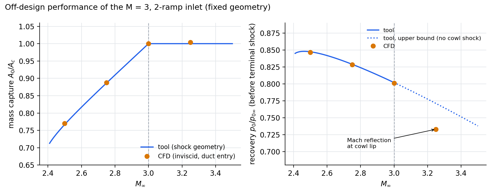

# Phase 3d — Off-design validation, M = 2.5 to 3.5 (fixed M = 3, 2-ramp geometry)

Phase 3d evaluates the M = 3 shock-on-lip design at other flight Mach numbers. The tool's
off-design model (`inletdesign offdesign`, `offdesign.py`) predicts mass capture and recovery
from the shock geometry of the fixed ramps. Inviscid CFD at M = 2.5, 2.75, 3.0 and 3.25 tests
those predictions.

## Results

All recoveries are measured **before** the terminal normal shock.

| M∞ | Regime (tool) | Capture, tool | Capture, CFD* | Recovery, tool | Recovery, CFD | Δ recovery |
|---:|---|---:|---:|---:|---:|---:|
| 2.50 | spillage | 0.767 | 0.770 | 0.8473 | 0.8466 | −0.08% |
| 2.75 | spillage | 0.887 | 0.888 | 0.8288 | 0.8283 | −0.06% |
| 3.00 | on-lip (design) | 1.000 | 1.000 | 0.8018 | 0.8011 | −0.08% |
| 3.25 | shock-in-duct | 1.000 | 1.004 | 0.771 (upper bound) | **0.733** | **−4.9%** |
| 3.50 | shock-in-duct | 1.000 | — | 0.738 (upper bound) | not quantified | — |

\*CFD capture is corrected for the line-integration bias measured at M = 3 (see Method).
The raw duct-entry values are 0.763, 0.880, 0.991 and 0.995.

**Underspeed (spillage) and design.** The tool predicts recovery to within 0.1% and mass
capture to within 0.4%. Point probes in the region behind each ramp shock reproduce the exact
oblique-shock Mach number and total pressure to within 0.3%. Below the design Mach both shocks
cross the cowl line ahead of the lip and the excess air spills; capture falls to 0.77 at
M = 2.5. The second ramp shock detaches below M ≈ 2.39, which sets the lower limit of the
attached-shock regime.

**Overspeed (M = 3.25).** All air is captured, as predicted, but the recovery is 4.9% below
the tool's estimate. Above the design Mach the ramp shocks pass inside the lip. The cowl inner
wall therefore meets undisturbed freestream at 33.8° of turning, close to the maximum
deflection for an attached shock (35.6° at M = 3.25). The resulting strong cowl-lip shock and
the ramp shocks interact through a **Mach reflection**: a short normal-shock stem forms at the
lip, with a subsonic layer along the cowl
(`figures/phase3d/fig_3d_M3p25_lip.png`). The tool models neither the cowl shock nor its
reflection, which is why it flags overspeed recovery as an upper bound. The duct-entry solution
is quasi-steady: mass-weighted p0 = 389,900 Pa ± 0.13% over the last 1500 iterations.

**M = 3.5** is reported qualitatively. The stem moves forward onto the external outflow
boundary, and the result depends on that boundary condition: recovery 0.50 with a pressure
outlet against 0.62 with a far-field. A quantitative overspeed analysis needs a realistic
external cowl.

## Method

- Inviscid, density-based, Roe-FDS, second order, ideal-gas air; freestream p = 10 kPa,
  T = 220 K.
- Domain: design-point internal domain plus an external spill region above the cowl line,
  upstream of the lip (`inletdesign cfd-domain --offdesign`). About 213,000 cells, minimum
  orthogonal quality ≈ 0.6.
- **External outflow boundary** (`OUTLET_EXT`): normal to the 33.8° duct direction, so the
  spilled flow leaves it supersonically for all attached-shock cases. The first version
  (vertical at the lip) let a subsonic normal component carry the imposed pressure upstream.
- **Top boundary**: a symmetry plane. A pressure-far-field there, with the flow tangential to
  it, leaked 2.9 kg/s (21% of the external stream) out of the domain.
- **Measurement station.** Results are taken on a cross-section at the duct entrance
  (`duct_entry`), not at the outlet. At underspeed the duct flow accelerates towards the outlet
  with *rising* total pressure, which is non-physical. This outlet-region artefact grows as the
  duct Mach number approaches 1: none at M = 3 (duct Mach 1.51), the last quarter of the duct
  at M = 2.75 (1.34), and beyond mid-duct at M = 2.5 (1.13).
- Recovery is the mass-weighted total pressure at `duct_entry`, from custom field functions
  `density·(u·n)` and `density·(u·n)·p0` (n = duct direction). These were verified against
  Fluent's own mass flow on the same line (difference 0.002%). For M ≤ 3.0 the area-weighted
  value was used (uniform duct flow).
- **Capture correction.** Mass flow integrated on line surfaces reads 0.9% low. This was
  calibrated at M = 3, where outlet mass flow gives capture 0.999. The M = 3 duct-entry ratio
  (0.991) is used to correct the other cases; the uncertainty is about ±0.5%.
- Transients after each Mach change took 3000–6000 iterations to reach the captured flow and
  settle. Each M was run from the converged neighbouring M.

## Limitations

- Inviscid. Phase 3b showed about −2.1% recovery and −0.6% capture from viscous effects at
  design, including corner separation.
- No outer cowl surface. The 33.8° duct turn would require an outer cowl at ≥ 33.8° incidence,
  which would itself carry a detached bow shock. This geometric consequence of the 2D
  external-compression layout limits the overspeed analysis.
- The overspeed (M = 3.25) result is quasi-steady, not steady.
- The outlet-region artefact at underspeed is avoided by the choice of measurement station,
  not explained.

## Files

- Figures: `docs/figures/phase3d/` (`fig_3d_offdesign_curve.png`, lip close-ups per Mach
  number, v1 diagnostic figures).
- v1 monitor histories: `cfd/offdesign_v1_results/`. Case and data files are local and
  git-ignored (`cfd/offdesign_3d_files/`).
